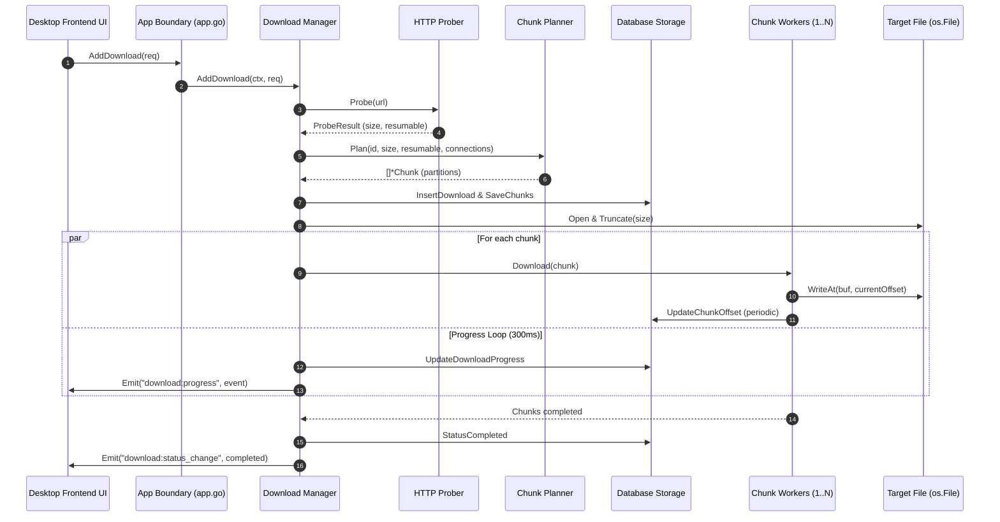

# Candak Architecture & SOLID Principles Guide

This document describes the architectural design of **Candak**, explaining how the codebase adheres to **SOLID design principles**, Go best practices, and concurrency patterns.

---

## High-Level Architecture

Candak uses a layered, hexagonal-inspired architecture with explicit dependency inversion:

```mermaid
graph TD
    UI["Desktop Frontend UI"]
    Bridge["Application Desktop Bridge (app.go)"]
    
    subgraph Core Domain & Orchestration
        Manager["Download Manager (internal/downloader)"]
        Planner["Chunk Planner (internal/planner)"]
        Prober["URL Prober (internal/prober)"]
        Metrics["Metrics Calculator (internal/downloader)"]
        Worker["Chunk Worker (internal/downloader)"]
    end
    
    subgraph Abstraction Layer (Interfaces)
        RepoIF["storage.Repository"]
        ProberIF["prober.URLProber"]
        PlannerIF["planner.ChunkPlanner"]
        EmitterIF["events.Broadcaster"]
        OpenerIF["sysutil.SystemOpener"]
    end
    
    subgraph Infrastructure Adapters
        Database["Database Storage (internal/storage/sqlite)"]
        HTTPClient["HTTP Client"]
        EventEmitter["Event Emitter (internal/events)"]
        OSOpener["OS System Opener (internal/sysutil)"]
    end

    UI <-->|IPC Events & Calls| Bridge
    Bridge -->|Uses| Manager
    Bridge -->|Uses| OpenerIF
    OpenerIF -.-> OSOpener

    Manager -->|Depends on| RepoIF
    Manager -->|Depends on| ProberIF
    Manager -->|Depends on| PlannerIF
    Manager -->|Depends on| EmitterIF
    
    RepoIF -.-> Database
    ProberIF -.-> Prober
    Prober --> HTTPClient
    PlannerIF -.-> Planner
    EmitterIF -.-> EventEmitter
    Manager --> Worker
    Worker --> HTTPClient
    Manager --> Metrics
```

---

## SOLID Principles Realization

### 1. Single Responsibility Principle (SRP)
*Each package and module has exactly one reason to change.*

| Component | Responsibility | Location |
| :--- | :--- | :--- |
| `storage.Repository` | Persistence of downloads, chunks, and URL history | [`internal/storage`](file:///Users/diksha/Documents/candak/internal/storage/repository.go) |
| `prober.URLProber` | Remote HTTP inspection, range checks, and filename sanitization | [`internal/prober`](file:///Users/diksha/Documents/candak/internal/prober/prober.go) |
| `planner.ChunkPlanner` | Mathematical partition of byte ranges across threads | [`internal/planner`](file:///Users/diksha/Documents/candak/internal/planner/planner.go) |
| `downloader.ChunkWorker` | Direct HTTP byte-range streaming into `io.WriterAt` | [`internal/downloader/worker.go`](file:///Users/diksha/Documents/candak/internal/downloader/worker.go) |
| `downloader.MetricsCalculator`| Transfer speed calculation using exponential moving average (EMA) | [`internal/downloader/metrics.go`](file:///Users/diksha/Documents/candak/internal/downloader/metrics.go) |
| `events.Broadcaster` | Asynchronous system-wide event notifications | [`internal/events`](file:///Users/diksha/Documents/candak/internal/events/emitter.go) |
| `sysutil.SystemOpener` | Native operating system desktop actions (Finder/Explorer/open) | [`internal/sysutil`](file:///Users/diksha/Documents/candak/internal/sysutil/opener.go) |
| `app.App` | Boundary adapter between Wails IPC and Go domain services | [`app.go`](file:///Users/diksha/Documents/candak/app.go) |

---

### 2. Open/Closed Principle (OCP)
*Software entities are open for extension, but closed for modification.*

- **Pluggable Storage**: The `storage.Repository` interface allows swapping SQLite for PostgreSQL, BadgerDB, or in-memory stores without touching `Manager` or the UI.
- **Pluggable Probers**: If Candak expands to support FTP, Torrent, or Cloud object stores (S3), new prober implementations can satisfy `prober.URLProber` without altering the core download engine.
- **Pluggable Event Sinks**: `events.Broadcaster` allows broadcasting to Wails desktop, a CLI output, or WebSockets for a headless server daemon.

---

### 3. Liskov Substitution Principle (LSP)
*Objects of a superclass or interface shall be replaceable with objects of its subclasses without breaking application behavior.*

- `events.NullBroadcaster` can substitute `events.WailsBroadcaster` in testing without any side effects or `nil` pointer panics.
- Any implementation of `storage.Repository` (such as `sqlite.Storage`) handles context cancellations, transactions, and error definitions predictably according to the domain contracts in `models.Err*`.

---

### 4. Interface Segregation Principle (ISP)
*Clients should not be forced to depend upon interfaces that they do not use.*

Instead of a monolithic database or manager interface, contracts are broken down into granular interfaces:

```go
type DownloadRepository interface {
    InsertDownload(ctx context.Context, dl *models.Download) error
    UpdateDownloadProgress(ctx context.Context, id string, downloadedSize, speed, eta int64, status models.DownloadStatus) error
    UpdateDownloadStatus(ctx context.Context, id string, status models.DownloadStatus, errMsg string) error
    GetDownload(ctx context.Context, id string) (*models.Download, error)
    GetAllDownloads(ctx context.Context) ([]*models.Download, error)
    DeleteDownload(ctx context.Context, id string) error
}

type ChunkRepository interface {
    SaveChunks(ctx context.Context, chunks []*models.Chunk) error
    UpdateChunkOffset(ctx context.Context, chunkID string, currentOffset int64, status models.ChunkStatus) error
    GetChunks(ctx context.Context, downloadID string) ([]*models.Chunk, error)
}

type HistoryRepository interface {
    RecordURLHistory(ctx context.Context, urlStr, filename string) error
    GetURLHistory(ctx context.Context, limit int) ([]*models.URLHistoryItem, error)
    ClearURLHistory(ctx context.Context) error
}
```

Components only ask for what they require (e.g., `ChunkWorker` only requires a `ChunkOffsetPersister` callback, not the entire database).

---

### 5. Dependency Inversion Principle (DIP)
*High-level modules should not depend on low-level modules. Both should depend on abstractions.*

`downloader.Manager` does not instantiate or directly import `*sqlite.Storage`, `*wailsRuntime`, or OS command packages. Instead, dependencies are passed into its constructor:

```go
type Config struct {
    Repository   storage.Repository
    Prober       prober.URLProber
    ChunkPlanner planner.ChunkPlanner
    Broadcaster  events.Broadcaster
    HTTPClient   *http.Client
    UserAgent    string
}

func NewManager(cfg Config) *Manager { ... }
```

The composition root is located in `app.go` (`App.startup`), assembling the concrete implementations and passing them to domain services.

---

## Concurrency & Data Flow

### Multi-Chunk Download Sequence



### Resume Mechanism (Crash-Safe)
1. Whenever bytes arrive, `io.WriterAt` places them at the exact byte index `chunk.current_offset`.
2. Periodically and on pause/exit, `UpdateChunkOffset` commits progress into the local database.
3. If the network drops or user pauses, `CurrentOffset` remains saved in the database.
4. On resume, the worker sends `Range: bytes={CurrentOffset}-{EndOffset}`, resuming instantly with 0 lost data.
